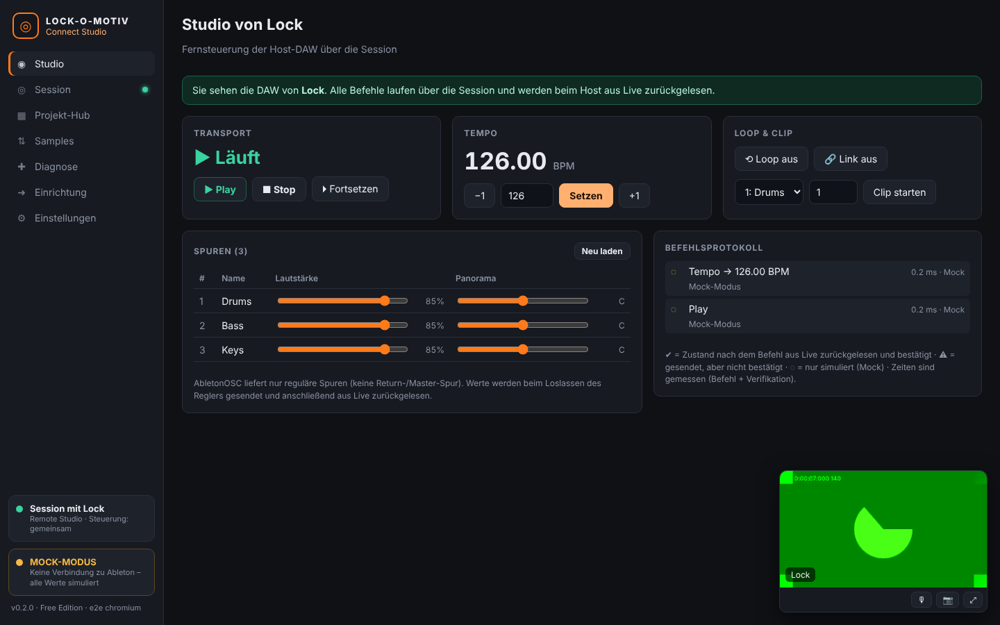

# LOCK-O-MOTIV Connect Studio – Free Edition

Gemeinsame Musikproduktion mit Ableton Live 12 über LAN und Internet – kostenlos, quelloffen, ohne Abos.

> **Entwicklungsstand 0.2.0 (Sprint 2):** Online-Zusammenarbeit – Video/Sprache, Bildschirm + DAW-Ton,
> gemeinsame Steuerung bis zur kompletten Übergabe, Samples per Drag & Drop, Projekt-Hub mit Ideen und Planer,
> Ableton-Link-Schalter für lokal. **Noch nicht unter Windows und nicht mit echtem Ableton Live getestet** –
> siehe [Testanleitung](docs/troubleshooting/windows-test-anleitung.md) und [Sprint-2-Bericht](docs/sprints/sprint-2.md).



## Zusammenarbeit (Sprint 2)

* **Session** im LAN (eingebauter Server) oder über das Internet ([selbst gehosteter Dienst](docs/deployment/selbst-hosten.md)),
  Einladung per Code, Sicherheitscode gegen Mithörer, automatische Wiederverbindung, gemessene Verbindungswerte.
* **Remote Studio:** Host-DAW gemeinsam steuern – *Nur ich / Gemeinsam / Komplett übergeben*, jederzeit zurückholen.
* **Dual Studio:** jeder mit eigenem Ableton, Transport/Tempo gekoppelt; im selben Netz **Ableton Link**.
* **Video + Sprache**, Bildschirmfreigabe mit **DAW-Ton auf eigener Spur**.
* **Samples per Drag & Drop**, SHA-256-geprüft, sicherer Empfangsordner, Übernahme ins Ableton-Projekt.
* **Projekt-Hub:** Ideen festhalten, Planer-Board mit Vorlage „Track fertigstellen“, offline nutzbar, automatischer Abgleich.

Anleitung: [docs/collaboration/zusammenarbeit.md](docs/collaboration/zusammenarbeit.md)

## Lokale DAW-Steuerung (Sprint 1)

* **Studio:** Play, Stop, Fortsetzen, BPM lesen/setzen, Loop, Spurliste mit Lautstärke und Panorama,
  Clip starten. Jeder Befehl wird nach dem Senden aus Live zurückgelesen (✔ bestätigt / ⚠ unbestätigt).
* **Mock-Modus:** Startet ohne Ableton; dauerhaft als „MOCK-MODUS“ gekennzeichnet.
* **Diagnose:** Ableton-Installation und -Prozess, AbletonOSC-Script, Ports, `/live/test` mit gemessener
  Laufzeit, API-Kompatibilität, Netzwerk-Exposition des OSC-Ports, OSC-Laufzeitstatistik.
* **Einrichtungsassistent** beim ersten Start (Ableton, AbletonOSC, OSC-Test, Kamera/Mikrofon, Netzwerk, Rolle; ASIO als „Sprint 3“ markiert).
* Lokale Einstellungen in SQLite.

## Schnellstart (Entwicklung)

```bash
npm ci
./scripts/fetch-abletonosc.sh      # Windows: .\scripts\fetch-abletonosc.ps1 (nur für Tests)
npm run dev                         # startet die App (Tauri dev)
npm test                            # TypeScript- + Rust-Tests
```

Voraussetzungen: Node.js 22, Rust stable, unter Windows die MSVC-Build-Tools; unter Linux die
[Tauri-Systempakete](https://v2.tauri.app/start/prerequisites/). Python 3 für die Integrationstests.

## Dokumentation

| Thema | Datei |
|---|---|
| Test unter Windows 11 + Ableton Live 12 | [docs/troubleshooting/windows-test-anleitung.md](docs/troubleshooting/windows-test-anleitung.md) |
| Zusammenarbeit (Bedienung) | [docs/collaboration/zusammenarbeit.md](docs/collaboration/zusammenarbeit.md) |
| Verbindungsdienst selbst hosten | [docs/deployment/selbst-hosten.md](docs/deployment/selbst-hosten.md) |
| Sprint-Berichte (Tests, Screenshots, offene Probleme) | [Sprint 1](docs/sprints/sprint-1.md), [Sprint 2](docs/sprints/sprint-2.md) |
| Architektur | [docs/architecture/overview.md](docs/architecture/overview.md) |
| Verifizierte AbletonOSC-API | [docs/architecture/abletonosc-api.md](docs/architecture/abletonosc-api.md) |
| Sicherheit / OSC-Firewall | [docs/security/](docs/security/) |
| Lizenzen, SBOM | [docs/licenses/license-review.md](docs/licenses/license-review.md), [THIRD_PARTY_NOTICES.md](THIRD_PARTY_NOTICES.md) |

## Tests

| Ebene | Wo | Läuft gegen |
|---|---|---|
| Unit | `services/daw-bridge/src`, `apps/desktop/src-tauri/src`, `packages/protocol`, `apps/desktop/src` | – |
| Integration | `services/daw-bridge/tests` | echter AbletonOSC-Code mit simulierter Live-API ([Harness](tests/integration/)) |
| E2E | `tests/e2e/run-e2e.mjs` | gebaute App über `tauri-driver` (inkl. echtes Hub-/Transfer-Backend) |
| E2E Zusammenarbeit | `tests/e2e/collab-e2e.mjs` | zwei Chromium-Teilnehmer, echter Signalisierungsdienst, echtes WebRTC, simuliertes Rust-Backend |
| Performance | `tests/performance/`, `cargo run -p lom-daw-bridge --example osc_latency` | Harness oder echtes Live |
| Hardware | manuell, [Testanleitung](docs/troubleshooting/windows-test-anleitung.md) | Windows 11 + Ableton Live 12 Suite |

## Lizenz

MIT. Drittkomponenten: [THIRD_PARTY_NOTICES.md](THIRD_PARTY_NOTICES.md). AbletonOSC (MIT) wird nicht
mitgeliefert, sondern vom Benutzer installiert. Ableton und Ableton Live sind Marken der Ableton AG;
dieses Projekt steht in keiner Verbindung zu Ableton.
