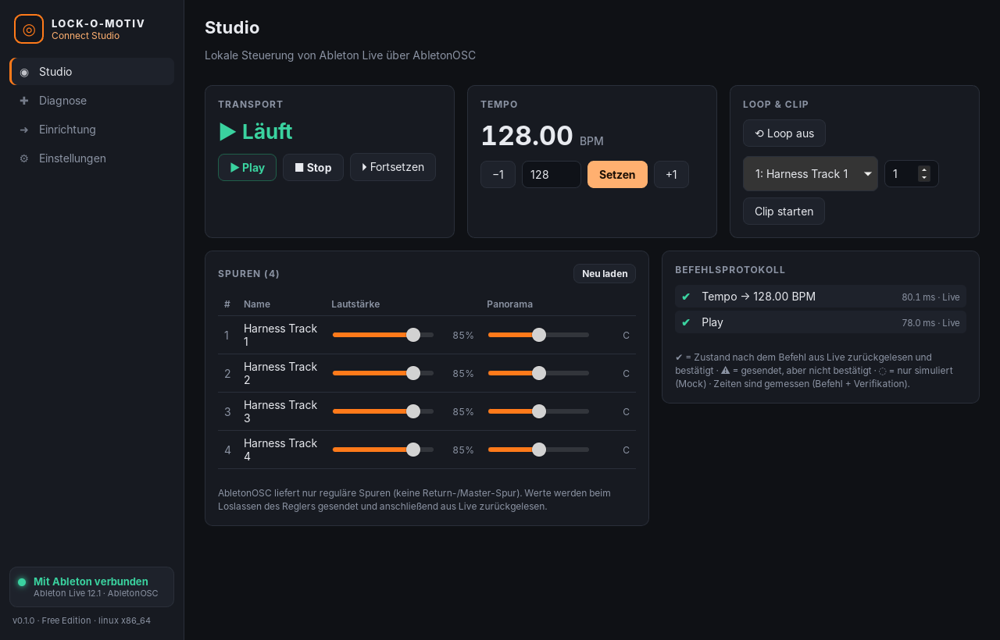

# LOCK-O-MOTIV Connect Studio – Free Edition

Gemeinsame Musikproduktion mit Ableton Live 12 über LAN und Internet – kostenlos, quelloffen, ohne Abos.

> **Entwicklungsstand 0.1.0 (Sprint 1 von 5):** Desktop-App mit lokaler Steuerung von Ableton Live über
> AbletonOSC, Mock-Modus und Diagnose. Sitzungen, Video, Audio, Sampletransfer und Fernsteuerung folgen in
> Sprint 2–4. **Noch nicht gegen echtes Ableton Live getestet** – siehe [Testanleitung](docs/troubleshooting/windows-test-anleitung.md).



## Was Sprint 1 kann

* **Studio:** Play, Stop, Fortsetzen, BPM lesen/setzen, Loop, Spurliste mit Lautstärke und Panorama,
  Clip starten. Jeder Befehl wird nach dem Senden aus Live zurückgelesen (✔ bestätigt / ⚠ unbestätigt).
* **Mock-Modus:** Startet ohne Ableton; dauerhaft als „MOCK-MODUS“ gekennzeichnet.
* **Diagnose:** Ableton-Installation und -Prozess, AbletonOSC-Script, Ports, `/live/test` mit gemessener
  Laufzeit, API-Kompatibilität, Netzwerk-Exposition des OSC-Ports, OSC-Laufzeitstatistik.
* **Einrichtungsassistent** beim ersten Start (Schritte 1–3 und 7; 4–6 als „Sprint 2/3“ markiert).
* Lokale Einstellungen in SQLite.

## Schnellstart (Entwicklung)

```bash
npm ci
./scripts/fetch-abletonosc.sh      # Windows: .\scripts\fetch-abletonosc.ps1 (nur für Tests)
npm run dev                         # startet die App (Tauri dev)
npm test                            # TypeScript- + Rust-Tests
```

Voraussetzungen: Node.js 22, Rust stable, unter Windows die MSVC-Build-Tools; unter Linux die
[Tauri-Systempakete](https://v2.tauri.app/start/prerequisites/). Python 3 für die Integrationstests.

## Dokumentation

| Thema | Datei |
|---|---|
| Test unter Windows 11 + Ableton Live 12 | [docs/troubleshooting/windows-test-anleitung.md](docs/troubleshooting/windows-test-anleitung.md) |
| Sprint-1-Bericht (Tests, Screenshots, offene Probleme) | [docs/sprints/sprint-1.md](docs/sprints/sprint-1.md) |
| Architektur | [docs/architecture/overview.md](docs/architecture/overview.md) |
| Verifizierte AbletonOSC-API | [docs/architecture/abletonosc-api.md](docs/architecture/abletonosc-api.md) |
| Sicherheit / OSC-Firewall | [docs/security/](docs/security/) |
| Lizenzen, SBOM | [docs/licenses/license-review.md](docs/licenses/license-review.md), [THIRD_PARTY_NOTICES.md](THIRD_PARTY_NOTICES.md) |

## Tests

| Ebene | Wo | Läuft gegen |
|---|---|---|
| Unit | `services/daw-bridge/src`, `apps/desktop/src-tauri/src`, `packages/protocol`, `apps/desktop/src` | – |
| Integration | `services/daw-bridge/tests` | echter AbletonOSC-Code mit simulierter Live-API ([Harness](tests/integration/)) |
| E2E | `tests/e2e/run-e2e.mjs` | gebaute App über `tauri-driver` |
| Performance | `tests/performance/`, `cargo run -p lom-daw-bridge --example osc_latency` | Harness oder echtes Live |
| Hardware | manuell, [Testanleitung](docs/troubleshooting/windows-test-anleitung.md) | Windows 11 + Ableton Live 12 Suite |

## Lizenz

MIT. Drittkomponenten: [THIRD_PARTY_NOTICES.md](THIRD_PARTY_NOTICES.md). AbletonOSC (MIT) wird nicht
mitgeliefert, sondern vom Benutzer installiert. Ableton und Ableton Live sind Marken der Ableton AG;
dieses Projekt steht in keiner Verbindung zu Ableton.
